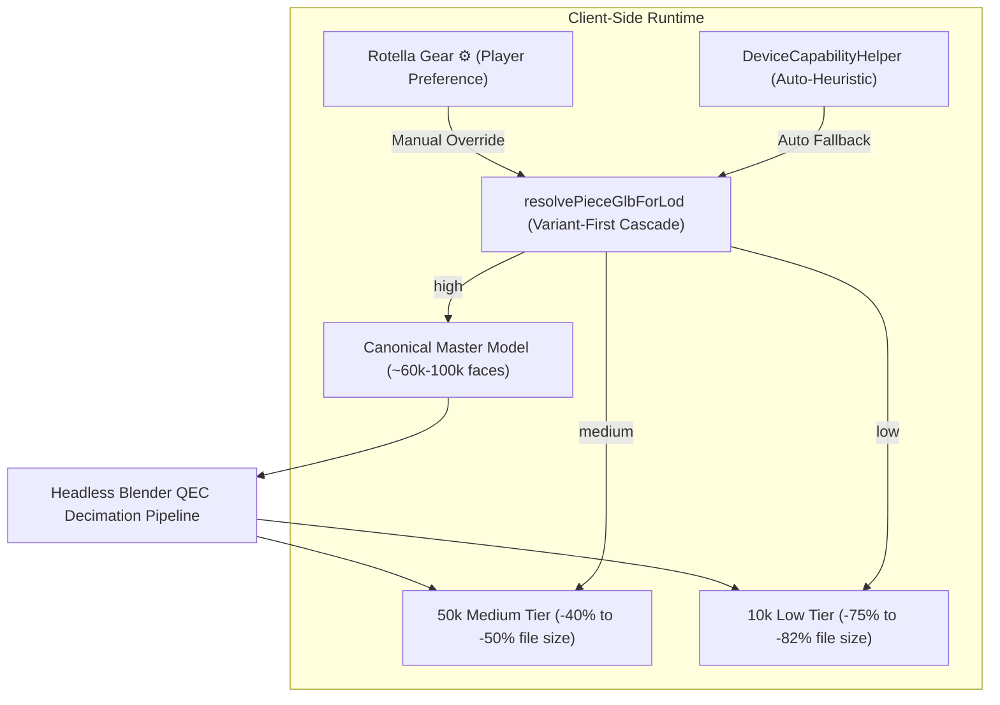

# Multi-Tier GLB LOD Decimation & Mobile Quality Tiers (Headless Blender)

> *"High-poly 3D models (~100k faces) look crisp on desktop gaming rigs, but choke mobile WebGL, burn phone batteries, and trigger out-of-memory WebGL context evictions. The clean solution is multi-tier decimation (10k/50k) that preserves materials and UVs 100%, coupled with a hardware heuristic and a clean UI gear override."*

---

## 1. Architecture Overview



---

## 2. Headless Blender Decimation Pipeline (QEC)

Quadric Edge Collapse (QEC) decimates geometry while preserving:
- UV unwrapping and texture coordinates
- PBR textures and normal maps
- Vertex colors and materials
- Watertight boundaries and $y=0$ grounding

### The Blender glTF Exporter File Extension Quirk
> [!WARNING]
> In Blender's Python API, `bpy.ops.export_scene.gltf(filepath=...)` automatically appends `.glb` if the filename does not strictly end with `.glb` or `.gltf`.
> If you specify `filepath="foo.glb.part"`, Blender writes `foo.glb.part.glb`.
> Any subsequent `os.replace("foo.glb.part", "foo.glb")` will fail with `FileNotFoundError`.
>
> **Solution**: For atomic writes, always use a dot-prefixed temporary filename ending in `.glb`:
> ```python
> part_path = out_path.parent / f".tmp_{out_path.name}"
> ```

### Reusable Pipeline Script (`generate_lod_tiers.py`)

```python
#!/usr/bin/env python3
"""Batch generate Multi-Tier GLB LODs (10k / 50k) using headless Blender QEC decimation.

Preserves:
- 100% of PBR textures, UV mappings, materials, vertex colors, and normals
- Grounding at min.y == 0.0m
- glTF 2.0 binary structure with valid VEC3 bounds
Writes atomically via .tmp_<name>.glb -> <name>.glb
"""
import os
import pathlib
import subprocess
import sys

BLENDER_SCRIPT = """
import bpy
import sys

in_path = sys.argv[-2]
out_path = sys.argv[-1]
target_faces = int(sys.argv[-3])

bpy.ops.wm.read_factory_settings(use_empty=True)
bpy.ops.import_scene.gltf(filepath=in_path)

mesh_objs = [o for o in bpy.data.objects if o.type == 'MESH']
total_faces = sum(len(o.data.polygons) for o in mesh_objs)

if total_faces > target_faces:
    ratio = max(0.01, min(1.0, target_faces / total_faces))
    for o in mesh_objs:
        mod = o.modifiers.new(name='Decimate', type='DECIMATE')
        mod.decimate_type = 'COLLAPSE'
        mod.ratio = ratio

bpy.ops.export_scene.gltf(filepath=out_path, export_format='GLB', export_apply=True)
"""

def decimate_one(in_path: pathlib.Path, out_path: pathlib.Path, target_faces: int) -> bool:
    # Notice: preserves .glb extension to prevent Blender from appending .glb.part.glb
    part_path = out_path.parent / f".tmp_{out_path.name}"
    cmd = [
        "blender",
        "--background",
        "--python-expr",
        BLENDER_SCRIPT,
        "--",
        str(target_faces),
        str(in_path),
        str(part_path),
    ]
    res = subprocess.run(cmd, stdout=subprocess.PIPE, stderr=subprocess.PIPE, text=True)
    if res.returncode != 0 or not part_path.exists():
        print(f"❌ Decimation failed for {in_path}:\n{res.stderr}")
        return False

    os.replace(part_path, out_path)
    in_kb = in_path.stat().st_size / 1024
    out_kb = out_path.stat().st_size / 1024
    savings = (1 - (out_kb / in_kb)) * 100
    print(f"✅ {out_path.name}: {in_kb:.1f} KB -> {out_kb:.1f} KB (-{savings:.1f}%)")
    return True
```

---

## 3. Decoupling Player UI from Polygon Targets

Always decouple user-facing preferences from internal technical metrics:

| Player UI Label (IT) | Player UI Label (EN) | Heuristic / Target Devices | Internal Polygon Target |
|---|---|---|---|
| `Auto` | `Auto` | Evaluated via `DeviceCapabilityHelper` | Dynamic |
| `Alta` | `High Quality` | Desktop gaming rigs, high-end workstations | Full master (~60k-100k) |
| `Media` | `Medium Quality` | iPads, Android tablets, laptops, $\le 4$GB RAM | ~50k faces |
| `Bassa` | `Low Quality` | Mobile phones (`maxDim < 900`), battery saving | ~10k faces |

> [!TIP]
> Expose user choice via a simple settings icon (e.g. ⚙️ Rotella) storing in `localStorage` and emitting `QUALITY_TIER_CHANGED`.
> Players understand "Qualità Alta / Bassa"; they do not want to see "10,000 Poligoni" in the HUD.
> This enables developers to adjust LOD decimation ratios without touching UI translations or player configs.

---

## 4. Variant-First LOD Resolution Cascade

When games feature character skin variants (e.g., Bishop `hat` vs `astrolabe` vs `rigged`, Queen `young` vs `wedding`), the resolution function must check variant-specific LODs **before** falling back to base registry entries.

### Anti-Pattern
```javascript
// ❌ BROKEN: Base piece lodGlbUrls overwrites variant selection!
export function resolvePieceGlbForLod(pieceKey, lodTier, opts = {}) {
  const def = REGISTRY[pieceKey];
  if (def.lodGlbUrls && def.lodGlbUrls[lodTier]) {
    return def.lodGlbUrls[lodTier]; // Silently drops opts.bishopVariant!
  }
  return getVariantGlb(pieceKey, opts);
}
```

### Clean Pattern: Variant-First Cascade
```javascript
// ✅ CORRECT: Variant-specific LOD checked first
export function resolvePieceGlbForLod(pieceKey, lodTier = 'high', opts = {}) {
  const familyId = opts.family || 'carlesso';
  const reg = FAMILY_REGISTRIES[familyId] || CHARACTER_REGISTRY;
  const def = reg[pieceKey] || CHARACTER_REGISTRY[pieceKey];
  if (!def) return '';

  let canonicalPath = def.glbUrl;

  // 1. Check variant overrides with specific LOD tiers
  if (familyId === 'carlesso' && pieceKey === 'b') {
    const bVar = opts.bishopVariant || 'hat';
    if (bVar === 'astrolabe') {
      if (lodTier === 'low') return 'assets/models/bishop-ale-2-remastered-10k.glb';
      return 'assets/models/bishop-ale-2-remastered.glb';
    }
    if (bVar && BISHOP_GLB_VARIANTS[bVar]) {
      canonicalPath = BISHOP_GLB_VARIANTS[bVar];
      if (bVar !== 'hat') return canonicalPath;
    }
  }

  // 2. Base piece LOD dictionary
  if (def.lodGlbUrls && def.lodGlbUrls[lodTier]) {
    return def.lodGlbUrls[lodTier];
  }

  // 3. Canonical fallback
  return canonicalPath;
}
```

---

## 5. Automated Testing Contract

Always verify LOD resolution with automated tests:
1. **Resolution Completeness**: Every role (`k, q, b, n, r, p`) in every family must resolve to a valid `.glb` path ending in `.glb` for `low`, `medium`, and `high`.
2. **Variant Preservation**: Selecting a variant (e.g., `astrolabe`) at `low` tier must return the decimated variant model (`*-10k.glb`), not the base character model.
3. **Graceful Fallback**: Unknown or unset tiers must return the canonical high-fidelity model without errors.
4. **GLB Header Verification**: Ensure every generated `-10k.glb` and `-50k.glb` file passes glTF 2.0 validation (valid magic header, length byte match, and `VEC3` min/max bounds for ground alignment).
