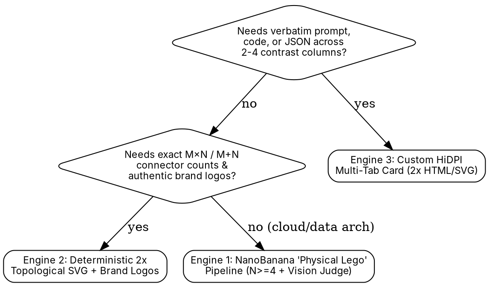

# Tri-Engine Slide Diagram Router & A/B Option Protocol 🧭🍌📐

No single diagram generator wins every slide. Route every technical slide visual to the **exact engine** that matches its cognitive structure, and **never destroy a strong existing slide** when proposing a visual alternative.

---

## 1. Decision Router: Pick the Right Visual Engine



| Visual Archetype | Winning Engine | Why It Wins | Canonical Exemplar |
|---|---|---|---|
| **Cloud Architecture & Physical "Lego" Pipelines** *(until `CloudArchDraw` MCP is in prod)* | **Engine 1 — Generative "Physical Lego" (`gemini-3-pro-image` / `imagen` + `N >= 4` tournament)** | Fuses tangible metaphors (`PDF` pages inside a bucket, stacked tables + green `ACL` padlock, `GPU` chip, `[1][2]` answer bubble) with cloud service icons in one memorable strip | `RAG 1/3: Homemade` (`GCS Bucket -> Cloud Run OCR -> Embeddings -> AlloyDB ScaNN + ACL -> GPU Reranker -> Gemini`) |
| **Many-Icon / Many-Arrow Topological Graphs** *(non-network diagrams)* | **Engine 2 — Deterministic `2x` Retina Topological SVG** | Guarantees exact connector math (`4 × 4 = 16` red spaghetti curves vs `4 + 4 = 8` hub connectors) and crisp, uncorrupted vector brand logos (`Claude`, `Cursor`, `Gemini CLI`, `Postgres`, `Slack`, `Drive`) | `Before MCP: M × N spaghetti` vs `After MCP: M + N one standard` |
| **Multi-Tab / Multi-Column Sequential Contrast Cards** (`1..4` or `(a)(b)(c)`) | **Engine 3 — Custom HiDPI Multi-Tab HTML/SVG (`2x` Retina + DOM Audit)** | Preserves 100% letter-accurate monospace `SYSTEM PROMPT`s and JSON (`{"name": "get_weather", "args": {"city": "ZRH"}}`) with micro-step vertical arrows (`↓`), numbered badges, and bottom verdict pills | `2024: grounding fragile models` & `4-Step Real JSON Function Calling Flow` |

---

## 2. Execution Rules per Engine

### Engine 1 — Generative "Physical Lego" Architecture (`gemini-3-pro-image`)
1. **Read [references/nanobanana-lego-prompts.md](references/nanobanana-lego-prompts.md)** for the proven prompt template and 5-gate vision rubric.
2. **Never ship a single-shot raw output**: generate **`N >= 4` candidates** into `/tmp/`, convert outputs to true RGBA/RGB `.png` (`Pillow`), and visually inspect every candidate to reject garbled labels (`ScaMN`), dark `#0F172A` frames, or backwards arrows.
3. **Pure `#FFFFFF` integration**: place aspect-fitted on the light slide canvas with zero border box so the illustration floats natively.

### Engine 2 — Deterministic `2x` Retina Topological SVG (Many Icons + Arrows)
1. Embed **real vector brand SVGs** (or crisp monograms when offline) and compute exact Bezier coordinates (`M x1 y1 C cx1 cy1, cx2 cy2, x2 y2`) anchored strictly to card borders.
2. Include bottom math summary pills (`4 × 4 = 16 custom integrations` in `#FEE2E2`/`#991B1B` vs `4 + 4 = 8 standard connectors` in `#DCFCE7`/`#166534`).
3. Render at `2x` Retina (`1232×560` -> `2464×1120` PNG) using the bundled CLI:
   ```bash
   python3 $SKILL_DIR/scripts/render_slide_diagram.py --mode bipartite --spec /tmp/mcp_spec.json --out /tmp/mcp_bipartite.png
   # Built-in smoke demo:
   python3 $SKILL_DIR/scripts/render_slide_diagram.py --demo-bipartite --out /tmp/demo_bipartite.png
   ```

### Engine 3 — Custom HiDPI Multi-Tab Contrast Cards (`1..4` Columns + Verbatim Code/JSON)
1. **Never** assemble 4-column code/JSON contrast cards from 30 loose Google Slides text boxes (fragile alignment and overflow), and **never** ask an image diffusion model to render multi-line prompts or JSON.
2. Render a `1232×560` CSS flexbox grid at `--force-device-scale-factor=2` (`2464×1120` PNG) with every CSS font `>= 18px`, semantic border colors (`#C5221F` red, `#B06000` amber, `#188038` green, `#1A73E8` blue), and an **automated Headless Chrome DOM audit** (`0` font/overflow warnings):
   ```bash
   python3 $SKILL_DIR/scripts/render_slide_diagram.py --mode multitab --spec /tmp/era_2024.json --out /tmp/era_2024.png
   # Built-in smoke demo:
   python3 $SKILL_DIR/scripts/render_slide_diagram.py --demo-multitab --out /tmp/demo_multitab.png
   ```

---

## 3. 🟨 Mandatory A/B Review Protocol: "Creation Is Expensive, Destruction Takes 2 Seconds"

Creativity and high-craft visuals cost real time and tokens; deleting or skipping a slide in Google Slides takes 2 seconds. Whenever an existing slide already has a decent visual and you generate a competing style or layout:

1. **NEVER overwrite, delete, or pre-emptively `skip` the existing slide!** Do not choose on the speaker's behalf.
2. **Duplicate Side-by-Side with Light-Yellow Highlighter Option Pills**:
   - Keep **both** slides active right next to each other in the deck.
   - Add a **soft light-yellow highlighter badge** (`fill: #FEF9C3`, `border: 1.5pt solid #F59E0B`, text `#78350F` bold `10pt`) in the top-right margin (`x=470pt, y=8pt, w=214pt, h=20pt` on a `720×405pt` Google Slide, or `.option-pill` in Marp):
     - Slide A: `Option 1: Deterministic Lego SVG`
     - Slide B: `Option 2: NanoBanana Physical Flow`
   - **Marp HTML snippet**:
     ```html
     <div style="position:absolute; top:14px; right:40px; background:#FEF9C3; border:1.5px solid #F59E0B; color:#78350F; font:700 13px 'Inter',sans-serif; padding:3px 12px; border-radius:999px;">
       Option 1: NanoBanana Physical Flow
     </div>
     ```
3. **Park Runner-Ups in `skip: true` or a Slide Graveyard — Never Destroy Good Art**:
   - Let the human speaker pick the winner visually and kill/park the runner-up in 2 seconds.
   - When asked to archive unchosen options that are still high quality, mark them `skip: true` (`slideProperties.isSkipped: true`) or move them to an end-of-deck **Slide Graveyard / Appendix** so they can be rescued for future talks. Only genuinely broken/ugly drafts get deleted.

---

## 4. Anti-Rationalization Table & Red Flags

| Agent Excuse | Reality & Required Action |
|---|---|
| *"I'll generate the 4-column `SYSTEM PROMPT` + JSON card in NanoBanana so it looks cohesive."* | Image models corrupt multi-line monospace JSON and prompts. **Use Engine 3 (`--mode multitab`)**. |
| *"I'll draw the 4-column JSON comparison using native Google Slides shapes."* | 30+ manual shapes drift, clip, and lose syntax-card polish. **Render Engine 3 HiDPI PNG (`2464×1120`, `0` DOM warnings)**. |
| *"One NanoBanana call is fast enough under deadline pressure."* | Single-shot outputs frequently misspell `ScaNN`/`OCR` or add grey borders. **Generate `N >= 4` and run the 5-gate vision check**. |
| *"I'll mark the old slide `isSkipped: true` and put my new diagram on the main slide to avoid clutter."* | Hiding the original robs the speaker of a 2-second visual comparison. **Keep both visible with `#FEF9C3` `Option 1` / `Option 2` pills**. |

### Red Flags — STOP Immediately If You Catch Yourself:
- Calling an image generator on a diagram whose teaching point is exact `M × N` connector math, real brand logos, or verbatim code/JSON.
- Replacing `image_url` / `replaceImage` over an existing strong visual without asking or creating side-by-side `Option 1` / `Option 2` yellow-pill slides.
- Permanently deleting a high-craft alternative slide instead of parking it in `skip: true` or the Slide Graveyard.

**COMPANION SKILL:** Pair with `presentation-that-riccardo-likes` for slide typography, `<= 10–20` word editorial copy, and whisper-thin footers.
